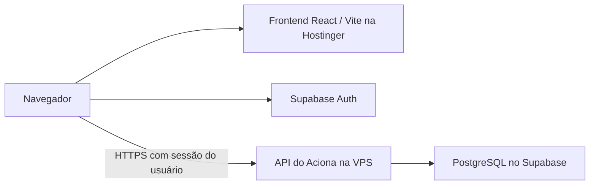

# Aciona · Base da API

Este exemplo verifica se uma revisão do Aciona sobe como serviço HTTP com Docker. Ele usa o servidor HTTP do Node.js 24 e não precisa de conta, banco ou dependências de aplicação.

## Arquitetura do MVP



Na aplicação, a API deverá validar a identidade e o vínculo com o condomínio em cada operação. O Supabase segue como provedor de autenticação e dados. A rota de saúde usa apenas uma resposta fixa e o SHA da revisão em execução.

## Teste local

```sh
node api/server.mjs
```

Em outro terminal, execute `node api/smoke.mjs`. A rota `GET /health` responde HTTP 200 com `status`, `service` e `revision`. Um método diferente recebe HTTP 405, e uma rota desconhecida recebe HTTP 404.

## Entrega na VPS

O projeto Docker `aciona-api` usa o proxy HTTPS existente na VPS. O contêiner entra em uma rede dedicada, publica sem abrir uma porta no host e monta `api/server.mjs` em modo somente leitura. O modelo [compose.vps.yaml](compose.vps.yaml) é mantido por um administrador da VPS. A imagem do Node.js fica fixada por digest.

Abra um pull request de `develop` para `deploy/aciona-api` quando a API estiver pronta para publicação. O merge dispara **Publicar API do Aciona**, que usa uma chave exclusiva do ambiente `aciona-api` no GitHub. O servidor só aceita a revisão que estiver na ponta dessa branch. A publicação aplica somente o serviço `api` no projeto `aciona-api` e restaura a configuração anterior se a verificação falhar.

Para validar a revisão em execução:

```sh
node api/smoke.mjs https://api-aciona.techtupa.com.br SHA_COMPLETO
```

Para reverter uma publicação, abra um PR com a reversão e publique a nova revisão pela mesma branch. A checagem dos PRs para `develop` roda sem a chave de deploy. O frontend continua na branch `deploy/aciona`.

O formato atual publica o exemplo de um arquivo. Quando a API passar a usar módulos ou dependências adicionais, atualize o contrato da publicação com o administrador antes de enviar a versão.
