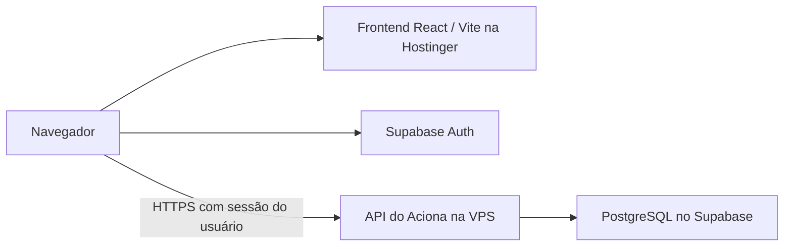

# Aciona · Base da API

Este exemplo verifica se uma revisão do Aciona sobe como serviço HTTP com Docker. Ele usa o servidor HTTP do Node.js 24 e não precisa de conta, banco ou dependências de aplicação.

## Arquitetura do MVP



Na aplicação, a API deverá validar a identidade e o vínculo com o condomínio em cada operação. O Supabase segue como provedor de autenticação e dados. A rota de saúde usa apenas uma resposta fixa e o SHA da revisão em execução.

## Teste local

```sh
node api/server.mjs
```

Em outro terminal, execute `node api/smoke.mjs`. A rota `GET /health` responde HTTP 200 com `status`, `service` e `revision`. Um método diferente recebe HTTP 405, e uma rota desconhecida recebe HTTP 404.

## Entrega na VPS

O projeto Docker `aciona-api` usa o proxy HTTPS existente na VPS. Ele tem um endereço próprio e publica o serviço sem abrir uma porta no host. O arquivo [compose.vps.yaml](compose.vps.yaml) recebe `ACIONA_REVISION` com o SHA completo de um commit do Aciona. A imagem é construída só com a pasta `api/` dessa revisão.

Depois de aplicar o Compose no projeto do Aciona, execute:

```sh
node api/smoke.mjs https://api-aciona.techtupa.com.br SHA_COMPLETO
```

Para voltar a uma revisão conhecida, aplique a configuração com o SHA anterior e repita o teste. O fluxo de publicação do frontend usa sua própria branch `deploy/aciona`. Os PRs da API para `develop` passam pela verificação **Validar API** do GitHub. O deploy automático da API depende de uma credencial de implantação restrita ao serviço; a validação do GitHub roda sem essa credencial.
