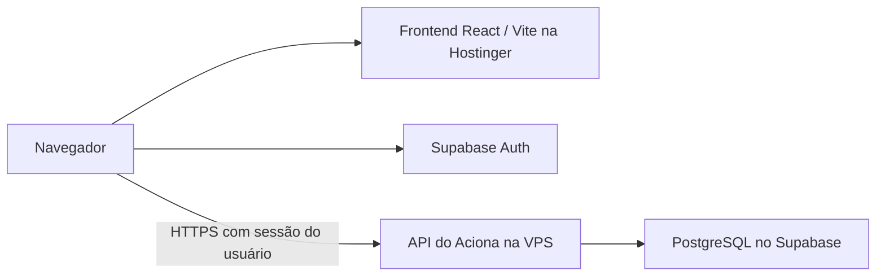

# Aciona · Base da API

Este exemplo verifica se uma revisão do Aciona sobe como serviço HTTP com Docker. Ele usa o servidor HTTP do Node.js 24 e não precisa de conta, banco ou dependências de aplicação.

## Arquitetura do MVP



Na aplicação, a API deverá validar a identidade e o vínculo com o condomínio em cada operação. O Supabase segue como provedor de autenticação e dados. A rota de saúde usa apenas uma resposta fixa e o SHA da revisão em execução.

## Teste local

```sh
node api/server.mjs
```

Em outro terminal, execute `node api/smoke.mjs`. A rota `GET /health` responde HTTP 200 com `status`, `service` e `revision`. Um método diferente recebe HTTP 405, e uma rota desconhecida recebe HTTP 404.

## Consulta de áreas (ORB-55)

`GET /areas` devolve as áreas de atendimento ativas, cada uma com as suas categorias. É a consulta prevista para os consumidores do ORB-19 e do ORB-57. As decisões de modelagem estão no [README do banco](../supabase/README.md#catálogo-de-áreas-de-atendimento-orb-55).

### Contrato

- Método: `GET`, sem parâmetros. O `OPTIONS` do navegador (pré-voo) responde 204.
- Autenticação: `Authorization: Bearer <access_token>`, com o token da sessão do Supabase Auth. A API consulta o banco com esse token e a RLS decide. A chave `service_role` não é usada.
- Só áreas ativas, sem paginação, mesma resposta para morador e síndico. O catálogo é pequeno e fixo, por isso vem inteiro numa resposta só.
- As áreas vêm em ordem de nome. As categorias de cada área seguem a coluna `ordem` do banco, que não aparece na resposta.
- `total` é o número de áreas devolvidas. Área sem categoria vem com `"categorias": []`. Área inativa fica de fora, junto com as categorias dela.
- Não existe rota de escrita: manutenção só por migração/acesso administrativo ao banco.

Resposta 200, com o catálogo cadastrado pelas migrações (não há dado pessoal):

```json
{
  "total": 11,
  "areas": [
    { "id": 9, "slug": "convivencia-e-administracao", "nome": "Convivência e administração", "categorias": [{ "nome": "Barulho e convivência", "slug": "barulho" }, { "nome": "Garagem e vagas", "slug": "garagem" }] },
    { "id": 1, "slug": "eletrica", "nome": "Elétrica", "categorias": [{ "nome": "Elétrica e iluminação", "slug": "eletrica" }] },
    { "id": 4, "slug": "elevadores", "nome": "Elevadores", "categorias": [{ "nome": "Elevadores", "slug": "elevador" }] },
    { "id": 11, "slug": "gas-e-instalacoes", "nome": "Gás e instalações", "categorias": [{ "nome": "Gás", "slug": "gas" }] },
    { "id": 10, "slug": "geral-e-triagem", "nome": "Geral e triagem", "categorias": [{ "nome": "Outros", "slug": "outros" }] },
    { "id": 2, "slug": "hidraulica", "nome": "Hidráulica", "categorias": [{ "nome": "Vazamentos e hidráulica", "slug": "hidraulica" }] },
    { "id": 7, "slug": "jardinagem-e-areas-externas", "nome": "Jardinagem e áreas externas", "categorias": [{ "nome": "Jardinagem", "slug": "jardim" }] },
    { "id": 6, "slug": "limpeza-e-conservacao", "nome": "Limpeza e conservação", "categorias": [{ "nome": "Limpeza e lixo", "slug": "limpeza" }] },
    { "id": 3, "slug": "manutencao-predial", "nome": "Manutenção predial", "categorias": [{ "nome": "Estrutura (trincas e infiltração)", "slug": "estrutura" }, { "nome": "Áreas de lazer", "slug": "lazer" }] },
    { "id": 8, "slug": "residuos-e-saneamento", "nome": "Resíduos e saneamento", "categorias": [] },
    { "id": 5, "slug": "seguranca-e-acesso", "nome": "Segurança e acesso", "categorias": [{ "nome": "Portaria e acesso", "slug": "portaria" }, { "nome": "Segurança e câmeras", "slug": "seguranca" }] }
  ]
}
```

### Erros

| Status | Quando | Corpo |
| --- | --- | --- |
| 401 | Pedido sem `Authorization: Bearer` | `{"error":"nao_autenticado","mensagem":"Entre na sua conta."}` |
| 401 | Token inválido ou expirado | `{"error":"sessao_invalida","mensagem":"Sua sessão expirou. Entre de novo."}` |
| 405 | Método diferente de `GET` e `OPTIONS`; a resposta traz `Allow: GET, OPTIONS` | `{"error":"method_not_allowed"}` |
| 500 | Erro inesperado na API | `{"error":"erro_interno","recuperavel":true}` |
| 503 | O Supabase não respondeu ou devolveu um erro que não é de sessão, ou a API está sem a configuração dele | `{"error":"falha_consulta","mensagem":"Não foi possível carregar agora. Tente de novo.","recuperavel":true}` |

### Testes

No CI, o workflow **Validar API** sobe o contêiner sem Supabase e roda o `smoke.mjs` e o `verificar-cors.mjs`. Para `/areas`, o smoke confere o 401 `nao_autenticado` sem token e o 405 do `POST` com `Allow: GET, OPTIONS`. O `verificar-cors.mjs` confere o pré-voo do `GET` com a origem do frontend. Como os dois passam a conferir `/areas`, só valem contra uma API que já tenha essa rota. Para conferir uma revisão anterior, use os scripts do commit dela.

O conteúdo da resposta e o acesso com login são testados no Supabase local pelo `api/teste-areas.mjs`, que não roda no CI. Ele cobre o pedido sem token, o token inválido (mesma resposta de `/ocorrencias`), o `POST` logado, o pré-voo, as 11 áreas com as 13 categorias na relação do teste pgTAP 07 e a resposta igual para o síndico. Se algum caso falhar, termina com código 1.

No `api/.env` (modelo em [.env.example](.env.example)), preencha o endereço e a chave publicável do Supabase local e as contas do seed: `morador.vista@teste.local` em `TESTE_EMAIL` e `TESTE_SENHA`, e `sindico.vista@teste.local` em `TESTE_EMAIL_SINDICO` e `TESTE_SENHA_SINDICO`. A senha fictícia está indicada no `supabase/seed.sql`. Na raiz do projeto:

```sh
npx supabase start
npx supabase db reset    # apaga o banco local e recria as contas do seed
node --env-file=api/.env api/server.mjs
```

Em outro terminal:

```sh
node --env-file=api/.env api/teste-areas.mjs
```

## Entrega na VPS

O projeto Docker `aciona-api` usa o proxy HTTPS existente na VPS. O contêiner entra em uma rede dedicada, publica sem abrir uma porta no host e monta `api/server.mjs` em modo somente leitura. O modelo [compose.vps.yaml](compose.vps.yaml) é mantido por um administrador da VPS. A imagem do Node.js fica fixada por digest.

Abra um pull request de `develop` para `deploy/aciona-api` quando a API estiver pronta para publicação. O merge dispara **Publicar API do Aciona**, que usa uma chave exclusiva do ambiente `aciona-api` no GitHub. O servidor só aceita a revisão que estiver na ponta dessa branch. A publicação aplica somente o serviço `api` no projeto `aciona-api` e restaura a configuração anterior se a verificação falhar.

Para validar a revisão em execução:

```sh
node api/smoke.mjs https://api-aciona.techtupa.com.br SHA_COMPLETO
```

Para reverter uma publicação, abra um PR com a reversão e publique a nova revisão pela mesma branch. A checagem dos PRs para `develop` roda sem a chave de deploy. O frontend continua na branch `deploy/aciona`.

### Preparação da publicação de ocorrências (ORB-49)

O Compose instalado em `/etc/aciona-api/compose.yaml` lê `/etc/aciona-api/runtime.env` (proprietário root, modo 0600). Nesse arquivo ficam `SUPABASE_URL`, `SUPABASE_PUBLISHABLE_KEY` e `ALLOWED_ORIGIN=https://aciona.techtupa.com.br`. Use a chave publicável com a sessão do usuário. O arquivo `.env` gerado em cada release guarda o SHA. Antes da promoção, compare o template instalado com o versionado e preserve a configuração persistente e a revisão anterior.

1. Confira que a revisão candidata inclui as rotas de gravação, consulta e vínculos (PR #10). Revise todas as migrações presentes nesse SHA, inclusive o catálogo do PR #15 se estiver integrado. Ao preparar o PR de promoção, confira o workflow resultante e retire a simulação histórica fixada em uma revisão antiga. O fluxo normal executa a simulação e aplica as migrações da própria revisão antes do SSH, usando o segredo existente `ACIONASUPABASEDB_URL` no ambiente `aciona-api`. As migrações são aplicadas em ordem de data. Não promova uma migração com data anterior à última já aplicada no hospedado: o `db push` recusa, e a publicação para no meio.
2. Antes da aplicação, confira o histórico de migrações e a possibilidade de recuperação do banco. O rollback do serviço restaura Compose e revisão da API. Migrações já aplicadas exigem recuperação própria ou correção compatível. O deploy fixa a CLI do Supabase na versão 2.122.0. Localmente, o `npx supabase` usa a versão mais recente, o que não muda a aplicação do SQL das migrações.
3. O inventário de 26/11 confirmou o hospedado vazio (sem tabelas, contas ou histórico de migrações): a primeira publicação aplica todas as migrações do zero, e os condomínios e as contas da demo precisam ser criados. Com acesso autorizado ao projeto hospedado, confira se Vista e Aurora e suas contas fictícias já existem. Reutilize os IDs encontrados. Crie apenas os registros ausentes e vincule o morador e o síndico aos respectivos condomínios. O seed completo é de desenvolvimento.
4. Após a promoção, confirme o SHA com o smoke e execute `node api/verificar-cors.mjs https://api-aciona.techtupa.com.br https://aciona.techtupa.com.br`. Em caso de falha funcional após o deploy, confira a revisão em execução e use o procedimento de reversão acima.
5. Com as contas fictícias, valide o papel e os condomínios via `GET /meus-condominios`. Registre uma ocorrência no Vista, localize o mesmo número na fila após recarregar e confira o isolamento do Aurora. Registre ambiente, revisão e resultado no ORB-49. A validação pelo navegador depende das integrações de entrada, formulário e fila.

O formato atual publica o exemplo de um arquivo. Quando a API passar a usar módulos ou dependências adicionais, atualize o contrato da publicação com o administrador antes de enviar a versão.
